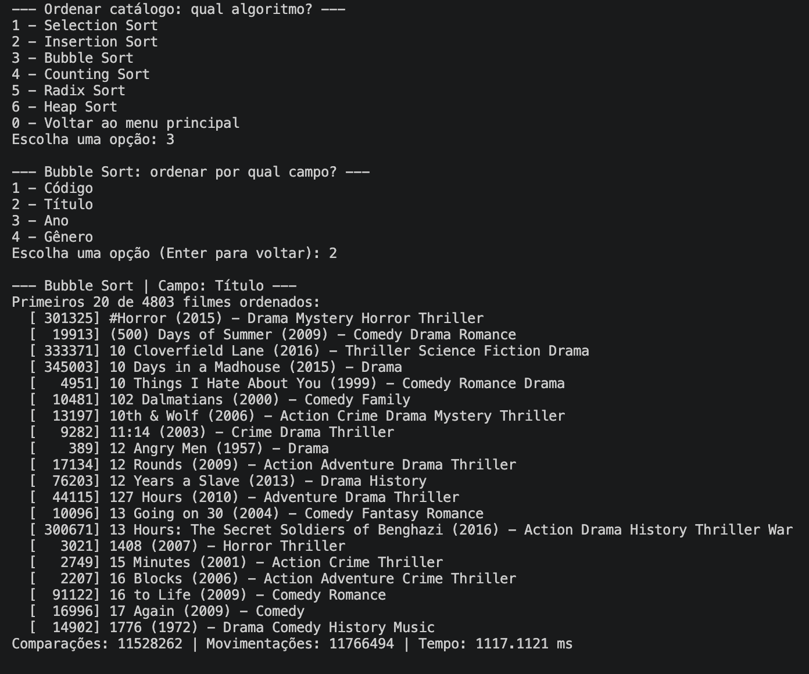
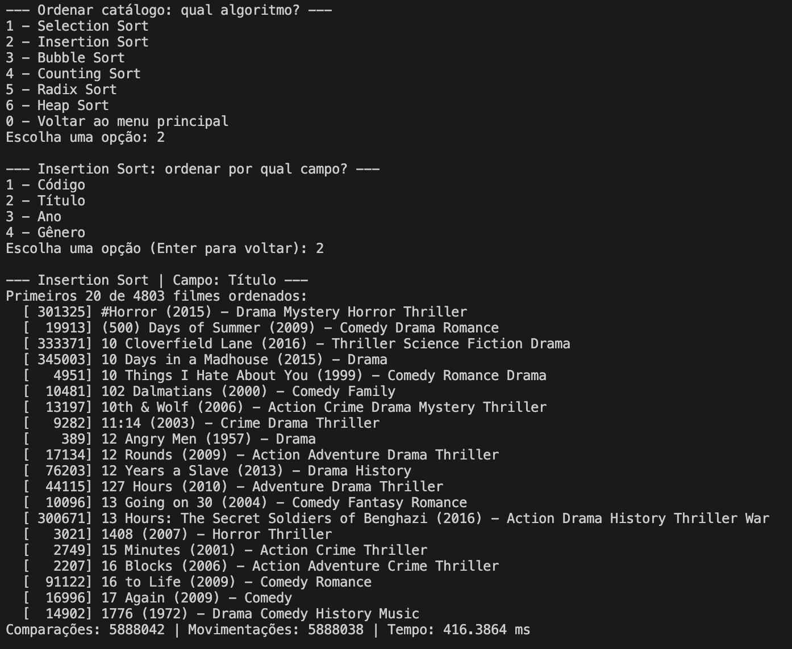
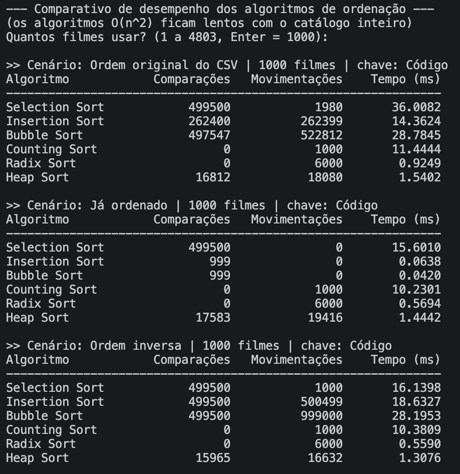

# G30_Ordernação_2026.2

Trabalho 2<br>
Conteúdo da Disciplina: algoritmos de busca e algoritmos de ordenação<br>

## Alunos
|Matrícula | Aluno |
| -- | -- |
| 21/1063256  |  Victor Hugo Rodrigues Guimarães |
| 21/1063229  |  Pedro Henrique dos Santos Ferreira |

## Sobre 
Sistema de busca de filmes com o objetivo de encontrar por codigo, titulo, ano ou genero.

Na segunda etapa o catálogo também pode ser **ordenado** por qualquer campo, usando os algoritmos vistos em aula. Cada algoritmo conta as **comparações** e **movimentações** feitas, para que o desempenho possa ser comparado.

### Algoritmos de ordenação (`ordenacoes.py`)

| Algoritmo | Melhor caso | Pior caso | Estável? | Campos |
| -- | -- | -- | -- | -- |
| Selection Sort | O(n²) | O(n²) | Não | todos |
| Insertion Sort | O(n) | O(n²) | Sim | todos |
| Bubble Sort | O(n) | O(n²) | Sim | todos |
| Counting Sort | O(n + k) | O(n + k) | Sim | código, ano |
| Radix Sort | O(d·(n + b)) | O(d·(n + b)) | Sim | código, ano |
| Heap Sort | O(n log n) | O(n log n) | Não | todos |

- Counting Sort e Radix Sort não comparam chaves (por isso aparecem com 0 comparações) e só funcionam com chaves inteiras.
- O Counting Sort é ótimo para o **ano** (k ≈ 100), mas fica lento para o **código** (k ≈ 460 mil), o que dá pra ver no comparativo.
- O vetor ordenado usado pela busca binária e pela interpolação agora é gerado pelo nosso **Heap Sort** em vez do `sorted()` do Python.

### Novas opções do menu
- **8 - Ordenar catálogo**: escolhe o algoritmo e o campo, mostra os primeiros 20 filmes ordenados, comparações, movimentações e tempo.
- **9 - Comparar desempenho dos algoritmos de ordenação**: roda os 6 algoritmos sobre uma amostra (padrão 1000 filmes) em três cenários — ordem original, já ordenado e ordem inversa.

## Screenshots

### Exemplo de ordenação com Bubble Sort


### Exemplo de ordenação com Insertion Sort


### Comparação de desempenho entre algoritmos de ordenção



## Video 
https://youtu.be/o7OGsmxZY_U


## Instalação 
Linguagem: Python<br>

## Uso 
Execute o código da main.py

```
python main.py
```